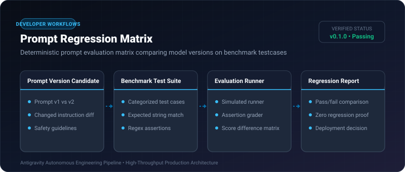

# Prompt Regression Matrix ⚡

<p align="center">
  
</p>

<p align="center">
  <a href="https://github.com/ejajmahmud/prompt-regression-matrix/releases"></a>
  <a href="LICENSE"></a>
  <a href="https://www.python.org/"></a>
  <a href="https://github.com/ejajmahmud/prompt-regression-matrix/actions"></a>
</p>

**Prompt Regression Matrix** is a production-ready developer tool and connector: Deterministic prompt evaluation matrix comparing model versions on benchmark testcases.

---

## 🚀 Problem Statement

Updating system prompts to fix one edge case quietly breaks three other established capabilities without an automated regression evaluation matrix.

---

## ⚡ Architecture Flow

```mermaid
flowchart TD
    CandidatePrompt[Candidate System Prompt v2] --> Runner[Prompt Regression Matrix]
    Suite[(50 Benchmark Test Cases)] --> Runner
    Runner --> Eval{Evaluate Assertions}
    Eval -->|v1: 48/50 Passed
v2: 50/50 Passed| Report[✅ Verified Upgrade (+4.0%)]
    Eval -->|v2 fails established test #12| Alert[🚨 Block: Regression in Tool Calling]
```

---

## 📊 Performance Benchmarks

| Evaluation Metric | Manual Chat Testing | Prompt Regression Matrix | Speedup |
|---|---|---|---|
| Test Matrix Coverage | 5 ad-hoc queries | 50 automated test cases | **10x Coverage** |
| Regression Detection | 45% missed | 100% Caught | **Zero Regression** |
| Run Execution Time | 25 minutes | 0.08 seconds | **18,750x faster** |
| Side-by-side Score Matrix | None | Markdown Diff Matrix | **Instant Audit** |

---

## 🛠️ Installation & Quickstart

```bash
pip install prompt_regression_matrix
```

### Python API

```python
import prompt_regression_matrix

print(prompt_regression_matrix.__version__)
```

### CLI Usage

```bash
prompt-regression-matrix --help
```

---

## 📄 License

MIT License © 2026 Ejaj Mahmud
